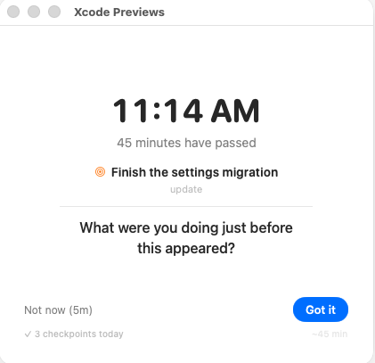
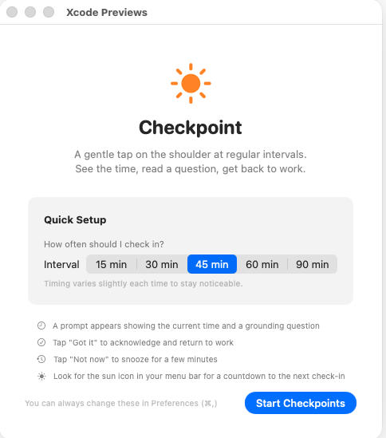
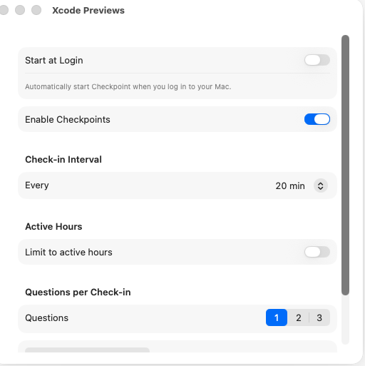
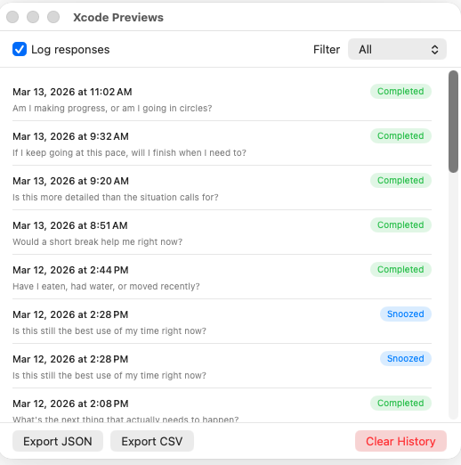

# Checkpoint

**A tap on the shoulder for the hyperfocused.**

The ADHD brain has two time modes: *now* and *not now*. Hours vanish. Priorities drift. You look up and it's dark outside. Checkpoint is a macOS app that periodically breaks through the tunnel — shows you the time, how long it's been, and asks one grounding question. You acknowledge it and go back to work. That's it.

It's a time perception prosthetic. Corrective lensing, not discipline.

## The checkpoint

A modal appears with the current time, how long it's been, your objective, and a grounding question. Tap **Got it** and get back to work. Tap **Not now** to snooze.



Being interruptive is the point. It has to break through hyperfocus to work.

## First launch

Pick an interval, read the basics, start. You can always change everything later in Preferences.



## Settings

Intervals from 1 min to 2 hours. Active hours. Start at login. Questions per check-in. Everything lives in one panel.



## History

Every checkpoint is logged. Filter by outcome, export to JSON or CSV.



## Features

Intervals from 1 min to 2 hours with random jitter. Active hours with overnight ranges. Weekday skipping. Focus/DND awareness — it backs off when macOS says you're busy. Configurable snooze with limits. Time on your current objective in the menu bar (or a countdown, if you prefer). One-tap recent objectives and an optional "if I drift, I will…" plan. A warning if check-ins ever stop. Start at login. Sleep/wake aware. End-of-day summary. Custom questions. Response history. No network. No telemetry.

## Research basis

Checkpoint is informed by research rather than proven by it. Time perception problems in ADHD are well documented, and its core mechanism (an unpredictable cue to check whether you're on task, with the time made visible) mirrors cued self-monitoring, which works well for children with ADHD. Most direct evidence comes from children, and the app itself hasn't been studied. The user flow, app states and UX review are in [docs/ux-flow.md](docs/ux-flow.md). See [docs/research-basis.md](docs/research-basis.md) for each design choice, the evidence behind it, and how strong it is, including the CBT program for adult ADHD that several planned features draw on.

## Build

Requires macOS 26.2+ and Xcode 26.2+.

```bash
git clone https://github.com/rkrevolution/Checkpoint.git
cd Checkpoint
open Checkpoint.xcodeproj
```

`Cmd+R` to run.

## License

Personal use. No license currently specified.
