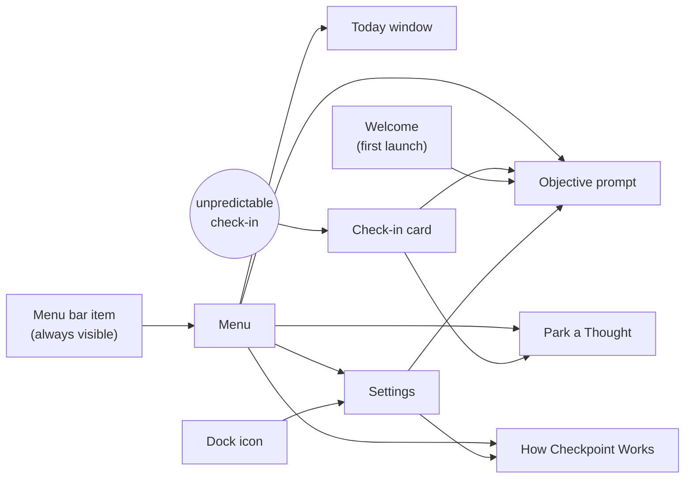

# Panels: what each part is for

Every part of Checkpoint serves one loop: **set what you're working on → work with time visible → get interrupted unpredictably → re-orient in one tap → see your day.** The rule underneath it: *time counts only while you're on a stated objective and present* (not before Start, not while paused, away or idle).

This page explains each panel: **why it exists** (the executive-function or time-blindness need it serves), **what it shows**, **when it appears**, **how to get there**, and **where it leads**. The loop and states are diagrammed in [ux-flow.md](ux-flow.md); the evidence behind design choices is in [research-basis.md](research-basis.md). Known clarity issues are noted under each panel.

## Map

---

## Menu bar item
- **Why:** Time blindness means elapsed time isn't felt. A constant, glanceable cue makes it visible without interrupting.
- **Shows:** time on your current objective (e.g. `1h20m`). Otherwise a state: `Paused`, `Focus`, `Off hours`, a snooze countdown, `Check-in` while a card is up, or a warning, `Check-ins stopped`. Hover for "On X for 1 h 20 min (not counting time away or idle)".
- **Why not a countdown:** a visible countdown to the next check-in lets you anticipate and brace for it, undoing the unpredictable timing. It's available as a setting, but off by default.
- **Debug copies:** orange icon.

## Focus strip (optional, off by default)
- **Why:** keeps what you meant to do in front of you (working memory) without interrupting, for people who don't glance at the menu bar.
- **Shows:** a small translucent strip at the top of the screen: objective and time on it ("1 h 20 min of ~2 h", red once over the estimate). Same style as the objective-switch toast.
- **Behaviour:** never takes focus; hidden from screen sharing; hidden while paused, away, or when nothing is tracked. Drag to move (position remembered); double-click to change the objective; **✕** turns it off.
- **Turn on:** menu › **Show Focus**, or Settings › General › Focus Strip.

## Menu (click the menu bar item)
- **Why:** one place for every way into, out of, and back into the loop, so nothing depends on remembering a shortcut.
- **Shows, top to bottom:**
  - **Warning** (only if check-ins stalled) and **Restart Check-ins**.
  - **Goals**, if set.
  - **Today…** (⌘T in the menu).
  - **Now:** objective, "1 h 20 min of ~1 h · since 9:40", if-then plan.
  - **Set / Change Objective…**, **Show Focus** (the focus strip), **Park a Thought…**, and **Parked (N)** (click one to mark it done).
  - **Status:** the state (no next-check-in time), last check-in time, whether a check-in is held for a call.
  - **Check In Now**, and **Pause / Resume** (⌃⌥⌘P from any app).
  - **How Checkpoint Works…**, **Settings…**, Debug (Debug builds only), **Quit**, version.

## Check-in card
- **Why:** the core intervention. It breaks through hyperfocus at an unpredictable moment (cued self-monitoring), restores time awareness (the real time, time on task), and prompts a quick, honest re-orientation.
- **When:** at the check-in interval ± random timing, unless you're away, paused, outside active hours, in Focus (if respected), or on a call (held until the call ends, then shown without sound). Also **Check In Now**.
- **Shows:**
  1. The time (largest).
  2. Your objective and "for 1 h 40 min · since 9:40" (red once past your estimate).
  3. Goals (one line).
  4. One grounding question, answered directly with **On track / Drifted / Switched**.
  5. **Not now** (snooze) and a count of today's check-ins. No "next check-in" time: unpredictability is the point.
- **Branches:**
  - **On track** (Return): back to work.
  - **Drifted:** shows your if-then plan, with a field to *park* what pulled you away ("distractibility delay").
  - **Switched:** pick a recent objective or type a new one; its time starts from here.
  - **No objective set** (prompt skipped): asks only "What are you working on?" with recent objectives.
- **Never:** over the screensaver or lock screen, or in screen shares and recordings.
- **Buttons wait 1.5 s** so a reflexive keypress can't dismiss it.
- **Window:** titled "Check-in", standard background (follows light and dark mode), sized to its content.

## Objective prompt ("What are you working on?")
- **Why:** naming the task turns a vague intention into something the app can hold for you (working memory), time, and remind you of. It's also where you set an estimate (to train time sense) and an if-then plan (an implementation intention).
- **When:**
  - First launch of a day, or when nothing is tracked: **"Good morning"** or **"Welcome back"**.
  - On **Resume** from pause, and after being away an hour or more: **"Welcome back"** plus "You were on: X · 1 h 40 min today".
  - From the menu (**Set / Change Objective…**), Settings › Now, or the card's **Switched** (inline).
- **Shows:**
  - The objective field, with a ⌄ dropdown and **Recent** buttons, so returning to a task is one tap and its time adds up under one name.
  - **More…** (remembers whether you left it open; the label summarizes what's set): **"If I drift, I will…"** with suggestions, and **"Should take about"** 15m / 30m / 1h / 2h.
  - **Skip** and **Start**.
- **Names:** capitalization and surrounding spaces don't matter ("building the app" is "Building the app"), and a typed name takes the spelling of a matching recent objective.
- **Never blocks:** check-ins run even if it's ignored or buried.

## Welcome (first launch only)
- **Why:** gets you to a working loop in one step: pick an interval, see the four steps, start.
- **Leads to:** the objective prompt.
- **Known issue:** two windows back to back ([#42](https://github.com/rkrevolution/Checkpoint/issues/42)).

## Today window (menu › Today…)
- **Why:** time blindness hides where the day went. This is the honest mirror: actual time per task, how your estimates compare, and how often you drifted. It also serves as the end-of-day review.
- **When:** any time from the menu, and automatically when active hours end.
- **Shows:**
  - Date and time, and **Goals**.
  - **Now:** objective, time against your estimate with a progress bar, if-then plan.
  - **Today:** the timeline of stretches, then **totals per objective** ("Building the app 2 h 40 min (2×)") and the day's total.
  - **Check-ins:** counts of On track / Drifted / Switched / Snoozed.
  - **Estimates, last 7 days:** "Tasks took 1.4× your estimates", with a padding hint.
  - **Parked for later:** tick items off.

## Park a Thought (menu, or Drifted on the card)
- **Why:** distractions ("reply to Sam") pull you away because they feel urgent. Writing them down to deal with later lets you stay on task without losing them (from the CBT program for adult ADHD).
- **Shows:** a one-line field.
- **Where parked thoughts appear:** Menu › Parked, Today, and the end-of-day review.

## How Checkpoint Works (menu, Settings)
- **Why:** a one-screen reminder of the loop and what happens automatically, for when you return after time away from the app. It doubles as About (version at the bottom).
- **Shows:** the four steps, the automatic behaviors (calls, away, ⌃⌥⌘P, the stall warning), the version.

## Settings (Dock icon, or menu › Settings…)
Clicking the Dock icon opens Settings: it's the app's main window.

### General
| Section | Why it exists |
|---|---|
| **Now** | See and change what the app thinks you're doing, any time |
| **Goals** | Up to three lines kept in view in the menu, on cards and in Today. Goals only help when visible at the moment you decide. |
| **Start at Login** | The prosthetic only works if it's always running. Also mentions ⌃⌥⌘P. |
| **Enable Checkpoints** | Master switch. Known issue: overlaps with Pause. |
| **Check-in Interval** | How often, roughly (randomized around it) |
| **Active Hours, Check in on** | Keep it quiet outside work hours and on days off |
| **Menu Bar** | Time on objective (default) or a countdown |
| **Questions per Check-in** | 1–3 grounding questions. Known issue: more than one adds load. |
| **Preview Checkpoint** | See the card with current settings |
| **Diagnostics** (collapsed) | For checking that things work: next and last check-in, state, away/idle/call/Focus, Start at Login status, version, data folder; **Copy** for bug reports. Collapsed because knowing when check-ins come makes them less effective. |
| **Version, How Checkpoint Works…** | Which build you're on, plus the help panel |

### Check-ins
| Section | Why it exists |
|---|---|
| **Sound** | An audible cue helps break hyperfocus. Skipped for check-ins held during a call. |
| **Timing (jitter)** | Randomness prevents habituation, capped at a quarter of the interval |
| **Snooze** | "Not now" is honest about its length and limited, so it can't become permanent avoidance |
| **Attention** | Full-screen dim for stronger interruption; optional breathing circle |
| **Calls** | "Wait until calls end": while the mic or camera is in use, a due check-in waits and appears without sound after the call (not paused or skipped). The card is always hidden from screen sharing. |
| **Focus** | Respect macOS Focus. Known issue: detection may not work ([#2](https://github.com/rkrevolution/Checkpoint/issues/2)). |

### Questions
- **Why:** the grounding questions should fit you. You can turn built-in ones off and add your own by category. The wording avoids shame.

### History
- **Why:** a record of every check-in and answer (On track / Drifted / Switched / snoozed, parked thoughts), so patterns are visible over weeks.
- **Shows:** a filter, export to JSON or CSV, and Clear.

## Automatic behavior (no panel)
| Behavior | Why |
|---|---|
| **Away** (sleep, display sleep, screensaver, lock) | Nothing fires or plays while you're gone; any open card closes; time isn't counted |
| **Idle** (5+ min without input) | Not counted as time on your objective, backdated to your last input |
| **Calls** | Check-ins wait and show quietly afterwards; call time counts as working |
| **Pause** | Stops check-ins and the clock until Resume |
| **Stall warning** | A time-blind user won't notice check-ins stopped, so the menu bar says so |
| **New day** | The first launch of a day asks what you're working on; yesterday's session closes |

## Development only
- **Debug menu, DEV badge, orange icon:** test away, Focus and call states and check-ins without waiting. Never in Release builds.
