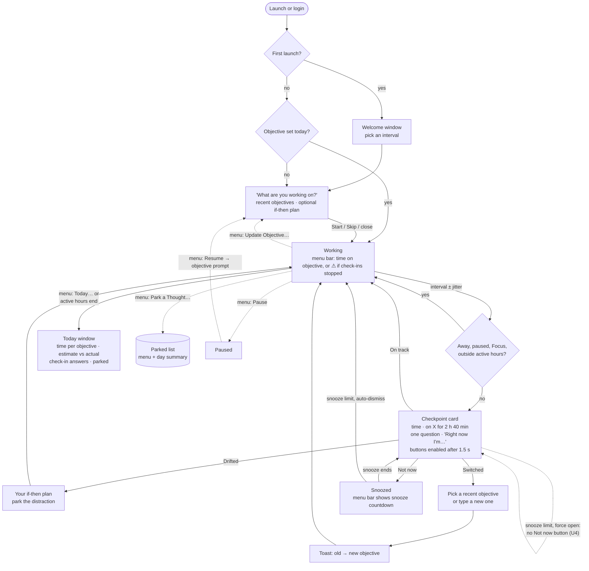
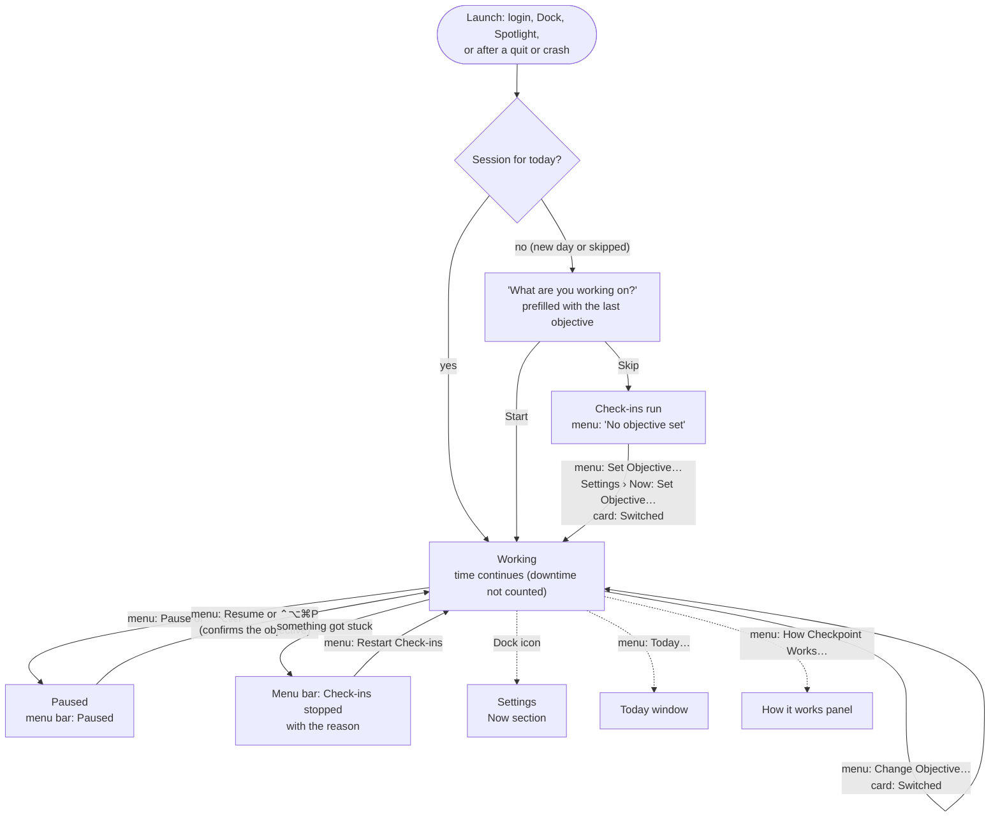
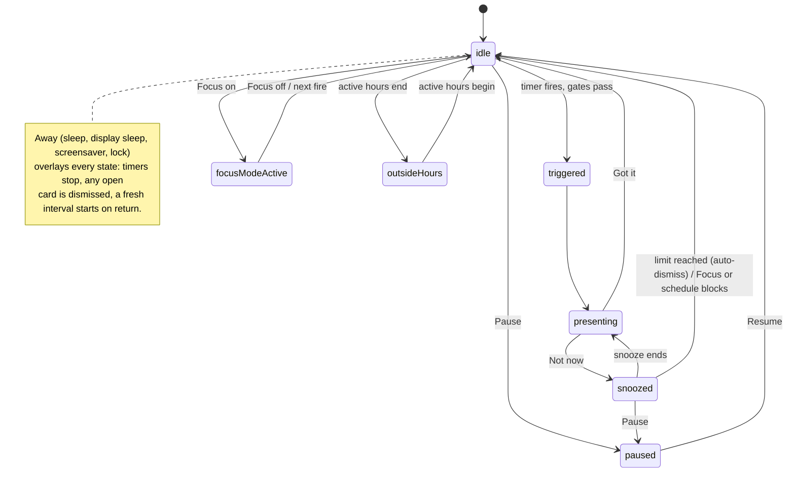
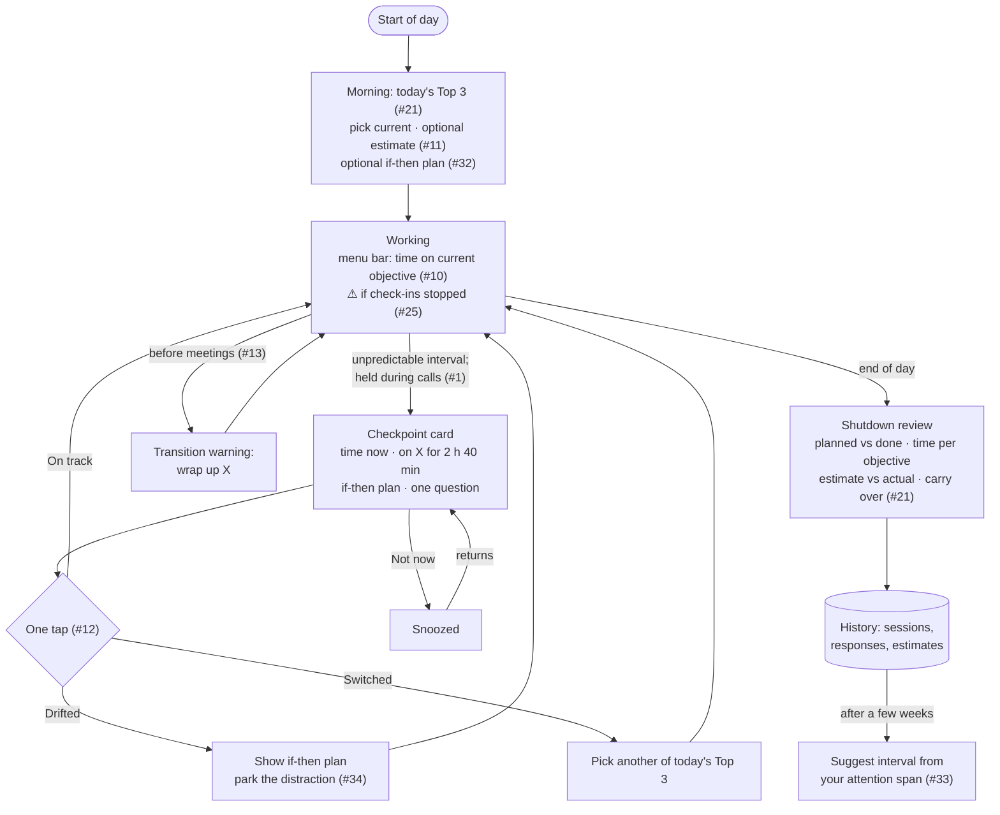

# User experience flow

How a user moves through Checkpoint today, the states the app can be in, what's unclear or illogical in that loop, and the loop we're building toward. Numbers like **(U3)** refer to the review findings below.

## 1. The user loop today

## 1b. Getting back into the loop

Every way out of the loop has a visible way back in, from the menu bar or a panel.

## 2. App states

## 3. Review findings

**Clear and logical**
- The core loop is simple: one card, two buttons, back to work. The 1.5 s button delay prevents reflexive dismissal without being annoying.
- The card puts the most important thing (the real time) first and largest.
- Snooze is honest about its length ("Not now (5m)") and capped.
- The objective can be changed in the moment, on the card, with a confirming toast.
- Away handling is invisible in the right way: nothing appears over the lock screen, and nothing piles up while you're gone.

**Unclear or working against the goal** (✅ = fixed on `feat/time-visible`)

| # | Finding | Why it matters | Fix |
|---|---|---|---|
| U1 | The objective prompt opens on **every** launch, including login, and pulls focus. | At login it competes with everything else starting; often dismissed unread. | ✅ Fixed: the prompt only appears when there's no objective for today. |
| U2 | The menu bar counts down to the **next check-in**. | It's about the app, not your time, and it **defeats the jitter**: research favours unpredictable cues, but a visible countdown lets you anticipate and brace. | ✅ Fixed: menu bar shows time on current objective (#10); countdown is an opt-in setting. |
| U3 | "Got it" is the only response; the question has no answer. | Becomes a reflex; History learns nothing. | ✅ Fixed: one-tap On track / Drifted / Switched; Drifted shows the plan and a park field, Switched picks a recent objective (#12, #34). Answers are saved to History. |
| U4 | At the snooze limit with "force open", the Not now button silently disappears. | Feels broken if you don't know why. | ✅ Fixed: the card says "Snooze limit reached". |
| U5 | The day summary only appears if active hours are on (off by default). | Most users never see the end-of-day review. | ✅ Fixed: a Today window (menu › Today…, any time) with time per objective, estimates vs actual, check-in answers and parked thoughts; it also opens when active hours end. |
| U6 | The card says "N minutes have passed", which mostly restates the interval. | Weak time cue. | ✅ Fixed: card shows "for 2 h 40 min · since 9:10" under the objective, and time since last check-in. |
| U7 | First launch shows two windows back to back (Welcome, then objective). | Feels like setup friction. | Ask for the objective on the Welcome screen. |
| U8 | The Preferences tab "Notifications" holds sound, timing, snooze, overlay and Focus settings, but the app sends no notifications. | Users look in the wrong place. | ✅ Fixed: tab renamed "Check-ins". |
| U9 | "update" (edit objective on the card) is tiny, low-contrast text. | Hard to discover. | ✅ Fixed: a "Change" button. |
| U10 | Weekday skipping exists but has no setting (#29). | Feature is invisible. | Add day toggles. |
| U11 | The app appears in both the Dock and the menu bar. | Unusual for a menu bar utility; clutters ⌘-Tab. | Setting: "Show in Dock" (off by default), with the menu bar as home. |
| U12 | Nothing tells you if check-ins stopped (#25). | A time-blind user won't notice the absence. | ✅ Fixed: menu bar shows "Check-ins stopped" with the reason and a Restart action. |

**Design decision: objectives are free text with one-tap recent suggestions.** A fixed dropdown can't cover new tasks, but switching back to an earlier task is common with ADHD, and time per objective only adds up when names match. The prompt offers the last week's objectives as buttons.

## 4. The loop we're building toward

